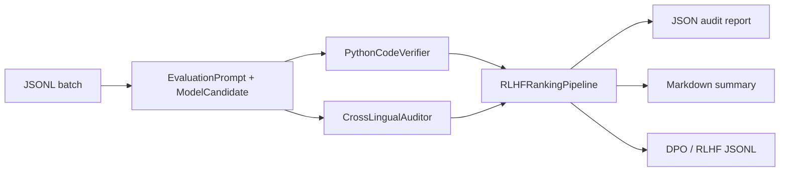

# lingua-rlhf-eval

Cross-lingual evaluation for English, French, Ukrainian, and Russian model responses. The repository combines deterministic fidelity checks, Python code auditing, and pairwise preference export for RLHF or DPO workflows.

## Scope

- Inspect fenced Python with `ast` before execution.
- Block imports and calls associated with shell access, process control, filesystem deletion, dynamic evaluation, and native code loading.
- Run approved assertions in a short-lived isolated Python subprocess with captured output and a timeout.
- Check preservation of numeric values, currencies, percentages, code identifiers, and named entities.
- Detect repeated function-word leakage across the four supported languages.
- Validate a small English-to-French technical glossary, including common false friends.
- Score two candidates on five normalized rubric dimensions and export the winning pair.

## Architecture



## Rubric

Scores are in the interval `[0, 1]` and combine as follows:

| Dimension | Weight | Automated signal |
|---|---:|---|
| Instruction following | 0.20 | Non-empty response and task-shaped output |
| Factuality | 0.20 | Numeric, currency, percentage, identifier, and entity preservation |
| Code correctness | 0.25 | Syntax, safety scan, assertions, and timeout outcome |
| Linguistic naturalness | 0.20 | Cross-language leakage and terminology findings |
| Safety | 0.15 | Dangerous AST imports and calls |

The score is a screening signal, not a substitute for expert review. The output retains findings so a reviewer can inspect why a pair was ranked.

## Quick start

```powershell
python -m venv .venv
.\.venv\Scripts\Activate.ps1
pip install -r requirements.txt
pytest
python cli.py --input data/sample_eval_batch.jsonl --out reports/eval_report.json
```

The CLI also writes `reports/eval_report.md` and `reports/eval_report.dpo.jsonl` unless alternate paths are supplied.

## Input shape

Each JSONL row contains `prompt_id`, `language`, `prompt`, `candidate_a`, and `candidate_b`. Optional fields are `domain`, `expected_entities`, `test_assertions`, and `terminology`.

```json
{
  "prompt_id": "en-algo-001",
  "language": "en",
  "prompt": "Write factorial(n).",
  "test_assertions": ["assert factorial(5) == 120"],
  "candidate_a": {"model_name": "model-alpha", "response": "```python\ndef factorial(n): ...\n```"},
  "candidate_b": {"model_name": "model-beta", "response": "..."}
}
```

## Package use

```python
from lingua_eval.rlhf_pipeline import RLHFRankingPipeline

pipeline = RLHFRankingPipeline()
evaluations = pipeline.evaluate_batch(rows)
pipeline.write_reports(evaluations, "reports/eval_report.json", "reports/eval_report.md", "reports/preferences.jsonl")
```

Python 3.11 or newer is required. The runtime dependencies are Pydantic and pytest.
